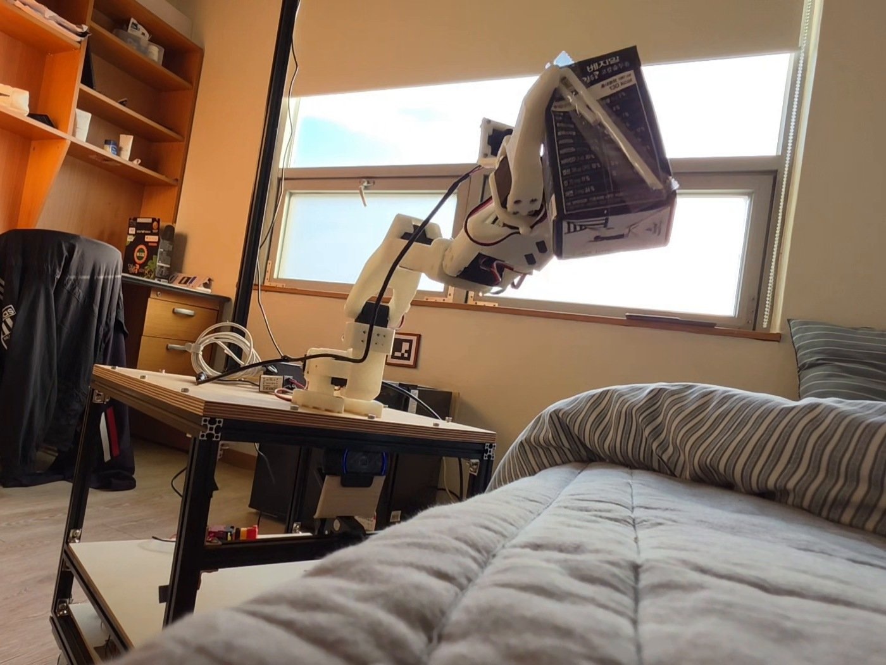
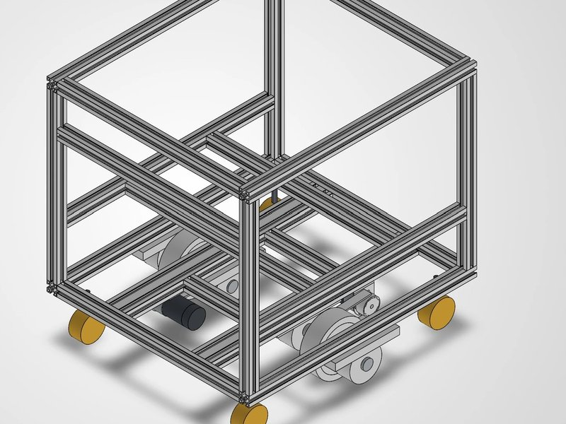
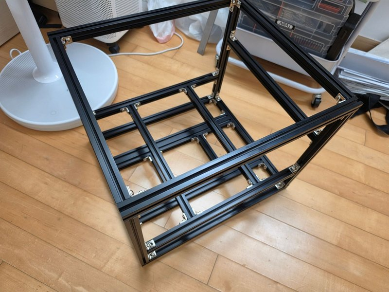
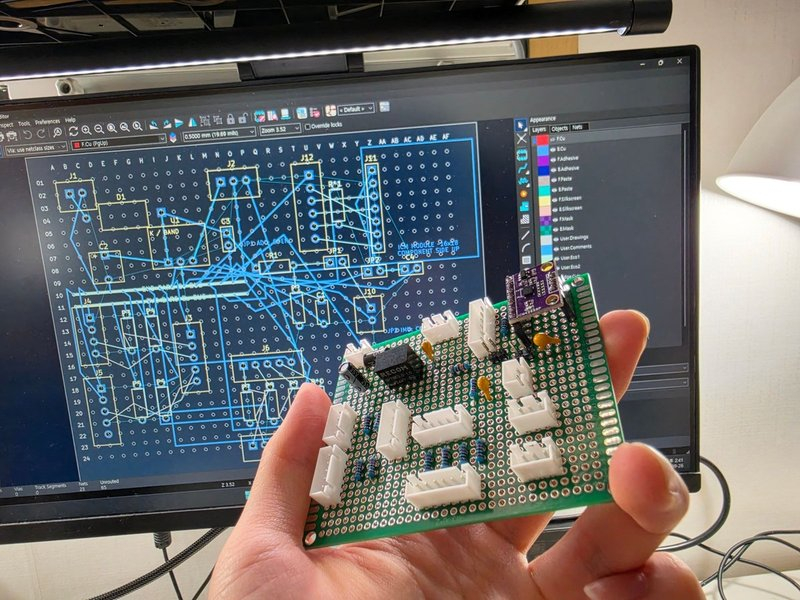
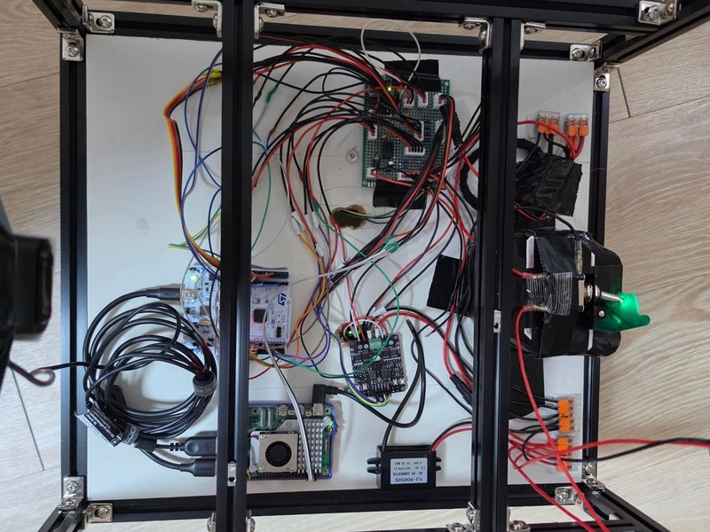
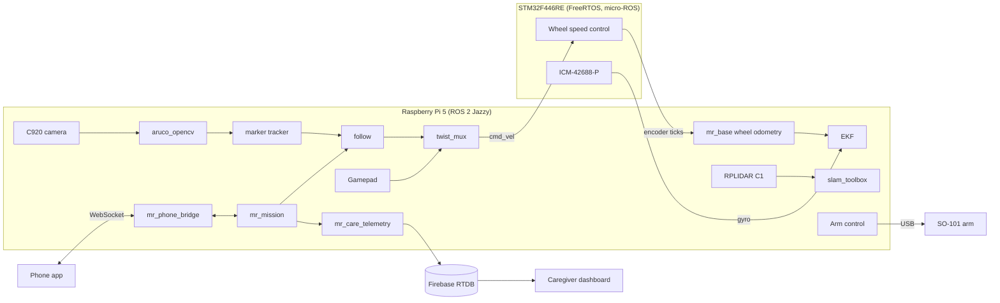

# Mobile Robot

<p align="center">
  
</p>

Maknae (Mobile Assistant for Kin's Needs And Errands) is a small mobile robot for older adults who have trouble getting around. The goal is a robot that brings things like a water bottle or glasses at home, walks along with the person outside, and lets family know when something goes wrong.

This repository has the robot itself: the frame CAD and base interface board, the STM32 firmware, and the ROS 2 packages on the Raspberry Pi 5. The phone app and the caregiver dashboard live in their own repositories (see [Related repositories](#related-repositories)).

The base, odometry, person following, the SO-101 arm, the phone link and caregiver telemetry all run on the real robot. LiDAR mapping was added recently, and navigation comes next.

## What it does

- Follows a person carrying an ArUco marker at about 1.1 m, at up to 0.25 m/s, and stops when the marker is lost.
- Picks up objects and hands them over with an SO-101 arm on the top plate.
- Can be driven with a gamepad at any time; `twist_mux` gives it priority over the follower.
- Fuses wheel odometry with the IMU gyro in a `robot_localization` EKF.
- Builds 2D maps with an RPLIDAR C1 and `slam_toolbox`.
- Talks to the phone app over WebSocket: pick a destination, start and stop the trip, and answer SOS requests with the phone's location.
- Sends status, events and SOS to Firebase so a caregiver can watch from the web dashboard and get push notifications.

## Hardware

| Part | Used here |
| --- | --- |
| Frame | Aluminium extrusion, 450 × 400 × 368 mm, 9.8 kg measured |
| Drive | 2 × JGB37-520 DC gear motor with hall encoder, 100 mm wheels, 264 mm track, casters |
| Motor driver | Cytron MDD3A |
| Microcontroller | STM32F446RE (NUCLEO-F446RE), FreeRTOS and micro-ROS |
| Computer | Raspberry Pi 5, Ubuntu 24.04, ROS 2 Jazzy |
| Arm | SO-101 with gripper, USB to the Pi |
| Sensors | Logitech C920 camera, ICM-42688-P IMU (on the MCU, SPI), RPLIDAR C1 |
| Power | 4S LiFePO4 battery with reverse-polarity diode |

The MCU and the Pi are wired directly, STM32 USART1 to Pi UART0 at 921600 baud, and micro-ROS runs over that link. The MCU closes the wheel speed loops and publishes encoders and IMU at 100 Hz. The firmware caps wheel speed at 0.76 m/s; the follow controller stays well below that.

<table>
  <tr>
    <td></td>
    <td></td>
    <td></td>
    <td></td>
  </tr>
  <tr>
    <td align="center">Frame CAD</td>
    <td align="center">Frame</td>
    <td align="center">Base interface board</td>
    <td align="center">Wiring</td>
  </tr>
</table>

## How it fits together



## Repository layout

```text
hardware/mobile_base/      frame CAD (STEP) and measured robot geometry
hardware/base_interface/   KiCad perfboard for the MCU, motor driver, IMU and power
firmware/base_controller/  STM32CubeMX project with FreeRTOS and micro-ROS
software/ros_pkgs/         ROS 2 packages
software/contracts/        JSON schemas shared with the phone app and the dashboard
software/patches/          patches for upstream ROS packages
```

| Package | Purpose |
| --- | --- |
| `mr_description` | URDF from measured geometry, meshes, RViz config |
| `mr_base` | wheel odometry, `odom` to `base_footprint` TF, IMU covariance |
| `mr_bringup` | launch files and config for camera, teleop, `twist_mux`, EKF, LiDAR, SLAM |
| `mr_aruco` | marker tracking filter, person following, alignment to fixed markers |
| `mr_mission` | trip state for the app, turns following on and off, battery estimate |
| `mr_phone_bridge` | WebSocket gateway for the phone app, plus a mock that runs without ROS |
| `mr_care_telemetry` | writes status and events to Firebase RTDB, with an offline queue |
| `mr_msgs`, `mr_aruco_msgs`, `mr_care_msgs` | messages and actions |

## Getting started

### Firmware

The firmware is a CMake project generated by STM32CubeMX. Build the micro-ROS static library once (it runs in Docker), then build and flash with an ST-Link.

```bash
cd firmware/base_controller
./micro_ros/build_libmicroros.sh
cmake --preset Release
cmake --build --preset Release
arm-none-eabi-objcopy -O binary build/Release/base_controller.elf build/Release/base_controller.bin
st-flash --reset write build/Release/base_controller.bin 0x08000000
```

### ROS 2 workspace on the Pi

```bash
mkdir -p ~/ros2_ws/src && cd ~/ros2_ws/src
git clone https://github.com/next-year-robotics/mobile-robot.git
cd ~/ros2_ws
rosdep install --from-paths src --ignore-src -y
colcon build --symlink-install
source install/setup.bash
```

The launch files start `micro_ros_agent` on `/dev/ttyAMA0` from a separate workspace, `~/microros_ws`; build it there following the micro-ROS setup guide. usb_cam 0.8.1 from apt stamps camera frames up to a second in the past, which makes the follower drop every sample. Build usb_cam from source in the same workspace with `software/patches/usb_cam-0.8.1-epoch-time-shift.patch` applied.

### Run

```bash
ros2 launch mr_bringup teleop.launch.py    # drive with the gamepad (hold LB or RB)
ros2 launch mr_bringup follow.launch.py    # follow the marker
ros2 launch mr_bringup slam.launch.py      # drive around slowly and build a map
```

## Roadmap

- Measure the LiDAR mount and tune SLAM
- Nav2 for going to saved places
- Simulation

## Related repositories

- [senior-care-android](https://github.com/next-year-robotics/senior-care-android): phone app for the person going out with the robot
- [senior-care-dashboard](https://github.com/next-year-robotics/senior-care-dashboard): web dashboard for caregivers
- [mobile-robot-booth](https://github.com/next-year-robotics/mobile-robot-booth): live dashboard and avatar used for demos

## License

- `software/` and `firmware/`: [Apache-2.0](LICENSES/Apache-2.0.txt)
- `hardware/`: [CERN-OHL-P-2.0](LICENSES/CERN-OHL-P-2.0.txt)
- Documentation and photos: [CC BY 4.0](LICENSES/CC-BY-4.0.txt)

Third-party code such as the ST HAL, CMSIS and FreeRTOS keeps its own license. See [LICENSE.md](LICENSE.md).
